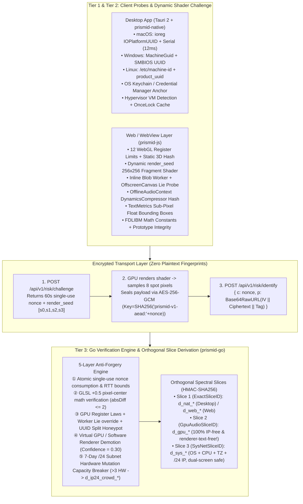

# PrismID Architecture Specification (`ARCHITECTURE.md`)

## 1. Design Philosophy: Why Traditional Fingerprinting Fails

Conventional client-side fingerprinting libraries collect ~20 browser attributes, concatenate them in JavaScript, compute a single SHA-256 hash (`visitorId`), and transmit that hash in plaintext to the server. In adversarial environments (credential stuffing, promotional abuse, automated account farming), this model fails for three structural reasons:

1. **Client-Side Self-Attestation & Replay**: Because the hash is computed in the untrusted client environment, headless scripts in Python or Go can fabricate random 64-character hex strings without launching a real browser or GPU.
2. **SHA-256 Avalanche Fragility**: If the server computes a single monolithic hash over all attributes, an attacker who modifies just **one** trivial attribute (e.g., changing `screen.width` from `1920` to `1921` or adding 1-bit noise to Canvas 2D) alters the entire SHA-256 digest, escaping association.
3. **Residential Proxy Pool Evasion**: If client IP addresses or subnets are mixed into the hardware hash, attackers using low-cost rotating residential proxies (where every request exits from a different `/24` ISP subnet) automatically get a brand-new fingerprint on every request without modifying a single hardware parameter.

---

## 2. Three-Tier Defense-in-Depth Architecture

PrismID replaces single-hash client self-reporting with a **Challenge-Response Proof-of-Render + Cross-Thread Lie Detector + Server-Derived Orthogonal Spectral Slices** pipeline:

---

## 3. Orthogonal Spectral Slices: Mathematical Formulation

When a client report passes decryption and the 5-layer anti-forgery verification, the Go engine (`prismid-go`) derives **three orthogonal slice IDs** using a server-side secret (`HMAC-SHA256(HMACSecret, CanonicalPayload)` truncated to 128-bit / 32 hex chars with typed prefixes):

### 3.1 Slice 1: `ExactSliceID` (`d_nat_*` or `d_web_*`)
- **Desktop Mode** (when a valid `NativeHardwareAnchor` is present):
  $$\text{ExactSliceID} = \texttt{"d\_nat\_"} \parallel \text{Hex}_{32}\big(\text{HMAC-SHA256}(K, \text{platform} \mid \text{hw\_uuid} \mid \text{serial} \mid \text{keychain\_anchor})\big)$$
  *Survives application data directory deletion, SQLite database wiping, and full app reinstallation.*
- **Browser Web Mode** (when running in pure browser without native anchor):
  $$\text{ExactSliceID} = \texttt{"d\_web\_"} \parallel \text{Hex}_{32}\big(\text{HMAC-SHA256}(K, \text{static\_webgl\_fp} \mid \text{webgl\_limits} \mid \text{audio} \mid \text{canvas2d} \mid \text{fonts} \mid \text{screen} \mid \text{tz})\big)$$
  *Survives cookie clearing, localStorage deletion, and incognito sessions.*

### 3.2 Slice 2: `GpuAudioSliceID` (`d_gpu_*`) — The Anti-Proxy & Anti-Noise Core
$$\text{GpuAudioSliceID} = \texttt{"d\_gpu\_"} \parallel \text{Hex}_{32}\big(\text{HMAC-SHA256}(K, \text{effective\_static\_webgl\_fp\_hash} \mid \text{webgl\_limits\_vector} \mid \text{audio\_compressor\_hash})\big)$$

> [!IMPORTANT]
> **Two Strict Invariants of `d_gpu_*`**:
> 1. **100% Decoupled from IP**: Neither the client's IP address nor `/24` subnet is ever included in `d_gpu_*`. Rotating residential proxies across 100 countries cannot alter `d_gpu_*`.
> 2. **100% Decoupled from Self-Reported `gpu_renderer` Text**: Attackers can easily override `getParameter(UNMASKED_RENDERER_WEBGL)` in JS to return `"NVIDIA RTX 4090"`. Therefore, `d_gpu_*` ignores the renderer string and relies exclusively on the actual 3D rasterization pixel hash (`static_webgl_fp_hash`), the 12 hardware register limits (`webgl_limits_vector`), and the `OfflineAudioContext` dynamics compressor integral (`audio_compressor_hash`). Furthermore, if `workerLie.ts` detects that the main thread was hooked, `effective_static_webgl_fp_hash` is taken directly from the unhooked `OffscreenCanvas` inside the Web Worker!

### 3.3 Slice 3: `SysNetSliceID` (`d_sys_*`) — Cross-Browser & Dual-Monitor Bridge
$$\text{SysNetSliceID} = \texttt{"d\_sys\_"} \parallel \text{Hex}_{32}\big(\text{HMAC-SHA256}(K, \text{os\_family} \mid \text{cpu\_cores} \mid \text{timezone} \mid \text{ip\_subnet})\big)$$

> [!IMPORTANT]
> **Cross-Engine & Multi-Display Compatibility Invariants of `d_sys_*`**:
> 1. **`navigator.deviceMemory` is strictly excluded from `d_sys_*`**: On macOS, Chromium (Blink) reports `deviceMemory = 8`, whereas Tauri's native `WKWebView` (Safari WebKit) does not implement this API (`undefined`). Excluding `deviceMemory` ensures a user's Chrome browser and Tauri desktop app on the same Mac produce the exact same `d_sys_*`.
> 2. **`screen.width` and `screen.height` are strictly excluded from `d_sys_*`**: Users with external monitors frequently drag windows between displays with different resolutions. Keeping screen dimensions out of `d_sys_*` (retaining them only in `d_web_*`) prevents false splits on multi-monitor setups.

---

## 4. Five-Layer Anti-Forgery & Lie Detection Engine

| Layer | Mechanism | What It Defeats | Server Action |
|---|---|---|---|
| **Layer 1: Dynamic Shader Challenge-Response** | Server issues 60s single-use `nonce` + `render_seed` `[s0, s1, s2, s3]`. Client renders `256x256` WebGL shader and returns 8 sampled RGBA pixels inside AES-256-GCM ciphertext. Server verifies each channel within `±2/255` quantization tolerance. | Headless Python/Go random hex generators, packet replay, F12 payload tampering. | Rejects with error (`ErrChallengeInvalid` or `ErrShaderPixelMismatch`). |
| **Layer 2: Cross-Thread Worker + OffscreenCanvas Lie Detector** | Spawns inline `Blob` Web Worker. Compares `WorkerNavigator` (`userAgent`, `hardwareConcurrency`, `platform`) and `OffscreenCanvas` WebGL renderer/hash against main thread. | Browser extensions & anti-detect hooks that only patch `window` on the main thread. | Flags `worker_lie_detected`, penalizes confidence, and substitutes Worker's real GPU hash into `d_gpu_*`. |
| **Layer 3: GPU Register Laws & Hardware Split Honeypot** | Validates OS/GPU pairing laws (e.g., Apple Silicon GPU must have `ALIASED_LINE_WIDTH_RANGE == [1,1]`, `MAX_TEXTURE_SIZE == 16384`, and non-Windows platform). Tracks distinct `d_nat_*` anchors per `d_gpu_*`. | Random field mutators & kernel/API hooks that randomize motherboard UUIDs (`IOPlatformUUID` / `MachineGuid`). | Flags `gpu_register_law_violation` or `native_uuid_split_trap` (`SpoofTrapTriggered = true`). |
| **Layer 4: Virtual GPU & Software Renderer Veto** | Detects `SwiftShader`, `llvmpipe`, `Mesa OffScreen`, `VMware`, `VirtualBox`, `Parallels`, `Microsoft Basic Render Driver`, `QEMU`, or native Hypervisor bit (`kern.hv_vmm_present`). | Cloud Docker Puppeteer/Playwright farms & VMware snapshot cloning farms. | Forces `Confidence = 0.30` (below the `0.60` authoritative threshold), keeping account in pending/unverified state. |
| **Layer 5: 7-Day `/24` Subnet Hardware Mutation Breaker** | Tracks distinct `d_gpu_*` slices seen on the same `/24` IPv4 (or `/48` IPv6) subnet over a 7-day rolling window. | Slow-rate replay bots replaying recorded real-device profiles from a single server/residential gateway. | When distinct hardware count reaches $\ge 4$, emits shared crowd node `d_ip24_crowd_<hmac>` to link all accounts on that subnet. |

---

## 5. Native Hardware Anchor Architecture (`crates/prismid-native`)

For desktop applications built with Tauri 2 or Rust:
- **macOS (`src/macos.rs`)**:
  - Executes `ioreg -rd1 -c IOPlatformExpertDevice` to extract `IOPlatformUUID` and `IOPlatformSerialNumber`, plus `sysctl` for `machdep.cpu.brand_string`, `hw.ncpu`, `hw.memsize`, and `kern.hv_vmm_present`.
  - **Performance guarantee**: Never invokes `diskutil info /` (~260ms). `ioreg + sysctl` completes in **~12ms** on Apple Silicon and is cached in a process-wide `std::sync::OnceLock` so all subsequent calls take **0ms**.
  - **OS Keychain Persistence**: Stores a 32-byte random hex anchor in the macOS Login Keychain (`security find-generic-password` / `add-generic-password`) with file fallback, surviving application uninstalls.
- **Windows (`src/windows.rs`)**:
  - Reads `HKLM\SOFTWARE\Microsoft\Cryptography\MachineGuid`, SMBIOS UUID (`wmic csproduct get UUID` / PowerShell CIM), and persists anchor in Windows Credential Manager / AppData Roaming vault.
- **Linux (`src/linux.rs`)**:
  - Reads `/etc/machine-id`, `/var/lib/dbus/machine-id`, `/sys/class/dmi/id/product_uuid`, and `/proc/cpuinfo` hypervisor flags.
