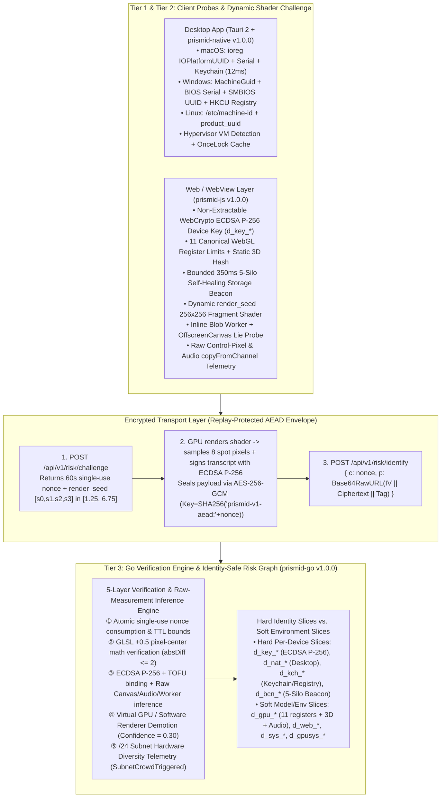

# PrismID Architecture Specification (`ARCHITECTURE.md`)

## 1. Design Philosophy & Threat Boundaries

Conventional client-side fingerprinting libraries collect ~20 browser attributes, compute a single SHA-256 hash (`visitorId`) in JavaScript, and send it in plaintext to the server. In anti-abuse environments, single-hash client self-reporting fails for three structural reasons:
1. **SHA-256 Avalanche Fragility**: Modifying a single attribute (such as adding 1-bit noise to Canvas 2D or resizing a window) alters the entire SHA-256 digest.
2. **Residential Proxy Evasion**: Mixing IP addresses into the device hash lets attackers rotate `/24` residential proxy subnets to get a new fingerprint on every request.
3. **Model-Collision False Positives**: Treating model-level hardware hashes (such as WebGL/Audio hashes shared by all stock MacBook Pro M3 laptops) as unique device identities falsely merges innocent colleagues in the same office or users across cities.

### 1.1 Explicit Trust Boundary (What Client Signals Can and Cannot Prove)

- **In Scope**: Detecting in-browser extensions, main-thread vs. Web Worker discrepancies, `Object.defineProperty` / `new Proxy(...)` API hooks, Canvas/Audio noise injection, partial storage clearing (`5-silo self-healing beacon`), packet replay (single-use `nonce`), and correlating multi-account abuse across rotating residential proxies.
- **Out of Scope**: Because the challenge `nonce`, `render_seed`, and GLSL math formula are visible to the client, an out-of-browser script can compute expected spot pixels on the CPU and seal arbitrary JSON payloads using the nonce-derived key. Therefore, the dynamic shader challenge + AEAD envelope provides **replay prevention, protocol freshness, and wire obfuscation**, not hardware-attested silicon proof. Production deployments should combine PrismID with authenticated user sessions, rate-limiting, and step-up challenges (e.g., Turnstile / WebAuthn).

---

## 2. Three-Tier Defense-in-Depth Architecture

---

## 3. Orthogonal Spectral Slices: Hard Identity vs. Soft Environment Slices

When a client report passes decryption and verification, `prismid-go` derives **per-device hard slices** and **shared-model soft slices** using `HMAC-SHA256(HMACSecret, CanonicalInput)` truncated to 128 bits (32 hex chars):

### 3.1 Per-Device Hard Identity Slices (Always Link Unconditionally when `Confidence >= 0.60`)

0. **`DeviceKeySliceID` (`d_key_*`) — Non-Extractable WebCrypto ECDSA P-256 Key Binding + TOFU**:
   $$\text{d\_key\_*} = \texttt{"d\_key\_"} \parallel \text{Hex}_{32}\big(\text{HMAC}(K, \texttt{"key|"} \parallel \text{pub\_key\_sec1\_hex})\big)$$
   *Generated with `extractable: false` on the private key and persisted in `IndexedDB`. Verified against the challenge transcript `prismid-v2-sig|<nonce>|<beacon_id>|<static_webgl_fp_hash>|<audio_compressor_hash>` (`device_key_bound: true`, Web `confidence = 0.95` — proves possession of a bound keypair rather than hardware silicon attestation) and bound via Trust-On-First-Use (TOFU) to `d_bcn_*`. Missing or rotated keys set `device_key_recovery_required: true` (`risk_pending: true`, `confidence: 0.30`) rather than marking the user as a spoof.*

1. **`ExactSliceID` in Desktop Mode (`d_nat_*`) & `KeychainSliceID` (`d_kch_*`)**:
   $$\text{d\_nat\_*} = \texttt{"d\_nat\_"} \parallel \text{Hex}_{32}\big(\text{HMAC}(K, \text{platform} \mid \text{hw\_uuid} \mid \text{serial} \mid \text{keychain\_anchor})\big)$$
   $$\text{d\_kch\_*} = \texttt{"d\_kch\_"} \parallel \text{Hex}_{32}\big(\text{HMAC}(K, \texttt{"kch|"} \parallel \text{keychain\_anchor})\big)$$
   *Survives application data directory deletion, SQLite database wiping, and full app reinstallation.*

2. **`BeaconSliceID` (`d_bcn_*`) — 128-Bit 5-Silo Self-Healing Beacon (Decoupled from GPU Drift)**:
   $$\text{d\_bcn\_*} = \texttt{"d\_bcn\_"} \parallel \text{Hex}_{32}\big(\text{HMAC}(K, \texttt{"bcn|"} \parallel \text{beacon\_id})\big)$$
   > [!IMPORTANT]
   > In `v1.0.0`, `d_bcn_*` is persisted across 5 browser storage silos (`localStorage`, `sessionStorage`, `IndexedDB`, `CacheStorage`, and `document.cookie`) and derived **exclusively** from the 128-bit cryptographic `beacon_id` without mixing in `d_gpu_*`. Consequently, browser upgrades (e.g., Chrome 130 $\to$ 131 altering ANGLE shader hashes, WebGL extension lists, or `OfflineAudioContext` output) **never** cause `d_bcn_*` drift.

### 3.2 Shared-Model & Environment Soft Slices (Conditional Promotion & Velocity Scoring)

1. **`GpuAudioSliceID` (`d_gpu_*`) — Canonical Hardware Model Cohort**:
   $$\text{d\_gpu\_*} = \texttt{"d\_gpu\_"} \parallel \text{Hex}_{32}\big(\text{HMAC}(K, \text{effective\_static\_webgl\_fp\_hash} \mid \text{canonical\_11\_webgl\_limits} \mid \text{audio\_compressor\_hash})\big)$$
   - **100% Decoupled from IP & Self-Reported `gpu_renderer` Text**.
   - **Canonical 11 Hardware Registers**: Strips the volatile WebGL extension list hash (`webgl_extensions_hash`) so browser updates adding new WebGL extensions do not alter `d_gpu_*`.
   - **Model-Collision & Spoof-Propagation Safety (`P0`)**: Because all laptops of the exact same hardware model (e.g., stock MacBook Pro M3) share `d_gpu_*`, `RiskGraph` **never** merges accounts with distinct `d_bcn_*` or `d_nat_*` anchors based on `d_gpu_*` alone—even if one user on that GPU model triggers `SpoofTrapTriggered == true` (such as a Brave/Firefox privacy-extension user or a griefing attacker). A spoofed observation on a soft slice merges **only** when sharing a hard anchor (`d_bcn_*`, `d_key_*`, `d_nat_*`), when on the same `/24` subnet + GPU (`d_gpusys_*`) within 25 minutes (where a clean-beacon peer is capped at `yellow + pending`), or when both accounts lack a beacon within 25 minutes, and spoof/soft edges expire after `DefaultSpoofEdgeTTL = 24h` / `DefaultSoftEdgeTTL = 7d`.

2. **`ExactSliceID` in Browser Web Mode (`d_web_*`) & `SysNetSliceID` (`d_sys_*`)**:
   $$\text{d\_web\_*} = \texttt{"d\_web\_"} \parallel \text{Hex}_{32}\big(\text{HMAC}(K, \text{static\_webgl\_fp} \mid \text{canonical\_11\_limits} \mid \text{audio} \mid \text{canvas2d} \mid \text{fonts} \mid \text{screen} \mid \text{tz})\big)$$
   $$\text{d\_sys\_*} = \texttt{"d\_sys\_"} \parallel \text{Hex}_{32}\big(\text{HMAC}(K, \text{os\_family} \mid \text{cpu\_cores} \mid \text{timezone} \mid \text{ip\_subnet})\big)$$
   - `d_sys_*` excludes `navigator.deviceMemory` and `screen.width/height` for cross-engine (`Blink` vs. `WKWebView`) and dual-monitor consistency.
   - **Zero Colleague False Merges (`R2` & `DeepSeek #3`)**: When clean beacons differ (`d_bcn_A != d_bcn_B` and `SpoofTrapTriggered == false`), `d_gpusys_*` (same `/24` + same GPU/OS) and `d_web_*` **never** merge accounts into `ComponentSubjects` and **never** mark them `red` (even if 3, 5, or 100 office colleagues register 1 minute apart). Instead, when $\ge 3$ distinct clean-beacon accounts arrive within the velocity window, `ComponentSnapshot` sets `BurstSuspicion = true`, `RiskPending = true`, and elevates `green` $\to$ `yellow` for step-up verification.

---

## 4. Five-Layer Verification & Telemetry Engine

| Layer | Mechanism | What It Detects | Server Action |
|---|---|---|---|
| **Layer 1: Dynamic Shader Challenge-Response** | Server issues 60s single-use `nonce` + `render_seed` `[s0, s1, s2, s3]` in `[1.25, 6.75]`. Client renders `256x256` WebGL shader and returns 8 sampled RGBA pixels inside AES-256-GCM ciphertext. | Packet replay (`GETDEL`), random byte scripts, broken/stubbed WebGL contexts. | Rejects with `CHALLENGE_NONCE_INVALID_OR_REPLAYED` or `SHADER_SPOT_PIXEL_MATH_MISMATCH`. |
| **Layer 2: Server-Side Raw Measurement Inference + Cross-Thread Worker** | Server independently inspects raw `canvas_control_rgba`, `canvas_readback_delta`, `audio_copy_hash`, `audio_silent_delta`, and raw `worker_*` telemetry alongside ECMAScript `§10.1.2.1` cyclic `__proto__` Proxy checks and ECDSA P-256 TOFU key binding. | Silent attackers setting `lies.* = false` while injecting Canvas/Audio noise, stripping Worker telemetry, or submitting invalid device-key signatures. | Sets `SpoofTrapTriggered = true`, substitutes Worker's unhooked GPU hash into `d_gpu_*`, and promotes `d_gpu_*` in `RiskGraph`. |
| **Layer 3: GPU Register Laws & Per-Anchor UUID Split Trap** | Validates OS/GPU register pairing laws and tracks distinct `d_nat_*` UUIDs observed under the same per-device `d_kch_*` or `d_bcn_*` anchor. | Impossible OS/GPU combinations & kernel/API hooks randomizing `HWUUID` on an existing installation. | Flags `gpu_register_law_violation` or `native_uuid_split_trap` (`SpoofTrapTriggered = true`). Two distinct physical MacBooks with distinct `d_kch_*`/`d_bcn_*` never trigger this trap. |
| **Layer 4: Virtual GPU & Software Renderer Veto** | Detects `SwiftShader`, `llvmpipe`, `Mesa OffScreen`, `VMware`, `VirtualBox`, `Parallels`, `QEMU`, or native Hypervisor bit (`kern.hv_vmm_present`). | Headless Docker browser farms & VM clones. | Assigns rule-tier weight `Confidence = 0.30` (below `0.60` threshold), keeping `RiskPending = true` (`RiskStatusUnknown`). |
| **Layer 5: Privacy-Safe Telemetry (`storage_healed` & `SubnetCrowdTriggered`)** | Records partial storage recovery (`storage_healed`) and `/24` subnet GPU diversity (`> MaxDistinctGPUsPerSubnet`) in `PrivacySignals` / `SubnetCrowdTriggered`. | Provides risk telemetry for downstream rules without merging CGNAT `/24` users or marking single Cookie-clearing users `red`. | Populates `PrivacySignals`, `SubnetCrowdTriggered`, and `CrowdSliceID` (excluded from `SliceNodes()`). |

---

## 5. Native Hardware Anchor Architecture (`crates/prismid-native` v1.0.0)

- **macOS (`src/macos.rs`)**:
  - Reads `IOPlatformUUID` and `IOPlatformSerialNumber` via `ioreg -rd1 -c IOPlatformExpertDevice` (~12ms, cached in `std::sync::OnceLock`), `sysctl` CPU/VM flags, and persists a 32-byte hex anchor in macOS Login Keychain (`security find-generic-password` / `add-generic-password`) with file fallback.
- **Windows (`src/windows.rs`)**:
  - Reads `HKLM\SOFTWARE\Microsoft\Cryptography\MachineGuid`, `Win32_BIOS.SerialNumber`, and `Win32_ComputerSystemProduct.UUID` (preserving all non-placeholder identifiers in `serial_number`), and persists the device anchor in `HKCU\Software\PrismID\DeviceAnchor` Registry with `%APPDATA%\PrismID\device_anchor.key` file fallback.
- **Linux (`src/linux.rs`)**:
  - Reads `/etc/machine-id`, `/var/lib/dbus/machine-id`, `/sys/class/dmi/id/product_uuid`, and `/proc/cpuinfo` hypervisor flags.
