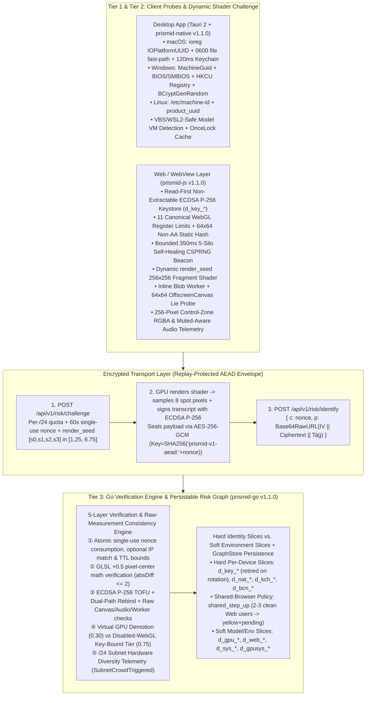

# PrismID Architecture Specification (`ARCHITECTURE.md` — `v1.2.1`)

## 1. Design Philosophy & Threat Boundaries

Conventional client-side fingerprinting libraries collect ~20 browser attributes, compute a single SHA-256 hash (`visitorId`) in JavaScript, and send it in plaintext to the server. In anti-abuse environments, single-hash client self-reporting fails for three structural reasons:
1. **SHA-256 Avalanche Fragility**: Modifying a single attribute (such as adding 1-bit noise to Canvas 2D or resizing a window) alters the entire SHA-256 digest.
2. **Residential Proxy Evasion**: Mixing IP addresses into the device hash lets attackers rotate `/24` residential proxy subnets to get a new fingerprint on every request.
3. **Model-Collision False Positives**: Treating model-level hardware hashes (such as WebGL/Audio hashes shared by stock MacBook Pro M3 laptops) as unique device identities falsely merges innocent colleagues in the same office or users across cities.

### 1.1 Explicit Trust Boundary (What Client Signals Can and Cannot Prove)

- **In Scope**: Detecting in-browser extensions, main-thread vs. Web Worker discrepancies, `Object.defineProperty` / `new Proxy(...)` API hooks on extensible functions, Canvas/Audio noise injection, partial storage clearing (`5-silo self-healing beacon`), packet replay (single-use `nonce`), and correlating multi-account abuse across rotating residential proxies while keeping shared household browsers usable (`shared_step_up`).
- **Out of Scope**: Because the challenge `nonce`, `render_seed`, GLSL math formula, and probe schemas are visible to the client, a modified SDK or custom out-of-browser script can compute expected spot pixels on the CPU and synthesize coherent raw measurement values (`canvas_control_rgba`, `audio_copy_hash`, `worker_*`). Therefore, the dynamic shader challenge, raw-measurement consistency checks, and AEAD envelope **raise the bar against extensions and unmodified-SDK wrappers** and provide **replay prevention and wire obfuscation**, not hardware-attested silicon proof. Production deployments should combine PrismID with authenticated user sessions, per-subnet rate-limiting, and step-up challenges (e.g., Turnstile via `Config.TurnstileVerifier` or WebAuthn).

---

## 2. Three-Tier Defense-in-Depth Architecture

---

## 3. Orthogonal Spectral Slices: Hard Identity vs. Soft Environment Slices

When a client report passes decryption and verification, `prismid-go` derives **per-device hard slices** and **shared-model soft slices** using `HMAC-SHA256(HMACSecret, CanonicalInput)` truncated to 128 bits (32 hex chars):

### 3.1 Per-Device Hard Identity Slices & Configurable Shared-Browser Policy

0. **`DeviceKeySliceID` (`d_key_*`) — Non-Extractable WebCrypto ECDSA P-256 Key Binding, Dual-Path Rebind & Edge Retirement**:
   $$\text{d\_key\_*} = \texttt{"d\_key\_"} \parallel \text{Hex}_{32}\big(\text{HMAC}(K, \texttt{"key|"} \parallel \text{pub\_key\_sec1\_hex})\big)$$
   *Reads existing key material from `IndexedDB` `_prismid_key_v1` before generating a new `extractable: false` P-256 keypair. Verified against `prismid-v2-sig|<nonce>|<beacon_id>|<static_webgl_fp_hash>|<audio_compressor_hash>` (`device_key_bound: true`, Web `confidence = 0.95` when WebGL is active, or `0.75` when WebGL is disabled by browser privacy policy). On proactive rotation (`previous_device_key` proof) or single-use `stepup_v2` MFA recovery, `RiskGraph.RetireSubjectDeviceKeyEdges` deletes superseded `d_key_old` edges so rotated keys do not permanently weld an account to stale/compromised key slices.*

1. **`ExactSliceID` in Desktop Mode (`d_nat_*`) & `KeychainSliceID` (`d_kch_*`)**:
   $$\text{d\_nat\_*} = \texttt{"d\_nat\_"} \parallel \text{Hex}_{32}\big(\text{HMAC}(K, \text{platform} \mid \text{hw\_uuid} \mid \text{serial} \mid \text{keychain\_anchor})\big)$$
   $$\text{d\_kch\_*} = \texttt{"d\_kch\_"} \parallel \text{Hex}_{32}\big(\text{HMAC}(K, \texttt{"kch|"} \parallel \text{keychain\_anchor})\big)$$
   *Survives application data directory deletion and app reinstallation.*

2. **`BeaconSliceID` (`d_bcn_*`) — 128-Bit 5-Silo Self-Healing Beacon (Decoupled from GPU Drift)**:
   $$\text{d\_bcn\_*} = \texttt{"d\_bcn\_"} \parallel \text{Hex}_{32}\big(\text{HMAC}(K, \texttt{"bcn|"} \parallel \text{beacon\_id})\big)$$
   > [!IMPORTANT]
   > In `v1.1.0`, `d_bcn_*` is persisted across 5 browser storage silos (`localStorage`, `sessionStorage`, `IndexedDB`, `CacheStorage`, and `document.cookie` with `; Secure` on HTTPS) and derived exclusively from the CSPRNG 128-bit `beacon_id` without mixing in `d_gpu_*`. Browser or ANGLE driver updates do not alter `d_bcn_*`.
   >
   > **Shared-Browser Policy (`HardAnchorPolicy`)**: Under the default `HardAnchorPolicySharedStepUp` (`shared_step_up`), 2–3 clean Web accounts sharing `d_bcn_*` / `d_key_*` (e.g., family members or lab terminals) link with `shared_hard_anchor_step_up` and receive `yellow + risk_pending: true` (`LogOddsScore >= 0.65`) rather than immediate `red`. Once $\ge 4$ accounts share the Web profile, or when tampering is active or Desktop `d_nat_*`/`d_kch_*` anchors collide, the component escalates to `red`. `HardAnchorPolicyStrict1To1` (`strict_1to1`) restores immediate `red` for $\ge 2$ accounts on promo-strict endpoints, whereas `HardAnchorPolicyDisabled` (`disabled`) disables hard-anchor cross-account merging while keeping soft-slice `BurstSuspicion` velocity step-up active.

### 3.2 Shared-Model & Environment Soft Slices (Conditional Promotion & Velocity Scoring)

1. **`GpuAudioSliceID` (`d_gpu_*`) — Canonical Hardware Model Cohort**:
   $$\text{d\_gpu\_*} = \texttt{"d\_gpu\_"} \parallel \text{Hex}_{32}\big(\text{HMAC}(K, \text{effective\_static\_webgl\_fp\_hash} \mid \text{canonical\_11\_webgl\_limits} \mid \text{audio\_compressor\_hash})\big)$$
   - **Decoupled from IP & Self-Reported `gpu_renderer` Text**.
   - **Canonical 11 Hardware Registers**: Strips the volatile 12th WebGL extension hash segment so browser updates adding new WebGL extensions do not alter `d_gpu_*`.
   - **Model-Collision & Spoof-Propagation Isolation**: Because laptops of the same hardware model share `d_gpu_*`, `RiskGraph` does not merge accounts with distinct clean `d_bcn_*` or `d_nat_*` anchors based on `d_gpu_*` alone—even if another user on that GPU model triggers `SpoofTrapTriggered == true`. Expired soft edges (`DefaultSoftEdgeTTL = 7d`) are pruned proactively during slice insertion, and soft-slice capacity evictions (`MaxSubjectsPerSlice = 256`) increment `GraphStats.SoftSliceEvictions` for observability.

2. **`ExactSliceID` in Browser Web Mode (`d_web_*`) & `SysNetSliceID` (`d_sys_*`)**:
   $$\text{d\_web\_*} = \texttt{"d\_web\_"} \parallel \text{Hex}_{32}\big(\text{HMAC}(K, \text{static\_webgl\_fp} \mid \text{canonical\_11\_limits} \mid \text{audio} \mid \text{canvas2d} \mid \text{fonts} \mid \text{screen} \mid \text{tz})\big)$$
   $$\text{d\_sys\_*} = \texttt{"d\_sys\_"} \parallel \text{Hex}_{32}\big(\text{HMAC}(K, \text{os\_family} \mid \text{cpu\_cores} \mid \text{timezone} \mid \text{ip\_subnet})\big)$$
   - **Colleague Isolation & Velocity Step-Up**: When clean beacons differ (`d_bcn_A != d_bcn_B` and `SpoofTrapTriggered == false`), `d_gpusys_*` and `d_web_*` do not merge accounts into `ComponentSubjects` and do not mark them `red`. When $\ge 3$ distinct clean-beacon accounts arrive within the velocity window (`6h` for `d_gpusys_*`, `25m` for `d_web_*`), `ComponentSnapshot` sets `BurstSuspicion = true`, `RiskPending = true`, and elevates `green` $\to$ `yellow`.
   - **Canonical Graph Complexity**: Connected-component evaluation sorts candidate edges canonically in $O(|E|\log|E|)$ time by `(SubjectCreatedAt, SubjectID, SliceID)` and executes Union-Find in $O(|E|\cdot\alpha(V))$ time up to `MaxComponentSize = 512`, producing deterministic components across edge arrival orders.

---

## 4. Five-Layer Verification & Telemetry Engine

| Layer | Mechanism | What It Detects | Server Action |
|---|---|---|---|
| **Layer 1: Dynamic Shader Challenge-Response & Per-IP / `/24` Quotas** | Server enforces explicit `DefaultMaxChallengesPerIP = 64` and `DefaultMaxChallengesPerIPSub = 1024` quotas (returning `CHALLENGE_RATE_LIMITED` / HTTP `429` without silently evicting active neighbor nonces) and issues a 60s single-use `nonce` + `render_seed` `[s0, s1, s2, s3]` in `[1.25, 6.75]`. Client renders `256x256` WebGL shader (when WebGL is enabled) and returns 8 sampled RGBA pixels inside AES-256-GCM ciphertext. | Packet replay (`GETDEL`), challenge-store flood DoS, random byte scripts, broken/stubbed WebGL contexts. | Rejects with `CHALLENGE_NONCE_INVALID_OR_REPLAYED`, `CHALLENGE_RATE_LIMITED` (`429`), or `SHADER_SPOT_PIXEL_MATH_MISMATCH`. |
| **Layer 2: Raw Measurement Consistency + Cross-Thread Worker** | Server inspects 256-pixel spatial uniformity (`canvas_control_rgba`, `canvas_readback_delta` $\le 2$ ICC tolerance), muted-aware audio (`audio_copy_hash`, `audio_silent_delta`), and `64x64` non-AA `OffscreenCanvas` Worker hashes alongside extensible-safe Proxy checks and ECDSA P-256 TOFU binding. | Browser noise extensions, anti-detect wrappers on the unmodified SDK, and naive boolean-flip edits (`lies.* = false`). *(Does not stop a custom client synthesizing raw fields; see Section 1.1.)* | Sets `SpoofTrapTriggered = true`, substitutes Worker's unhooked GPU hash into `d_gpu_*`, and evaluates conditional spoof rules in `RiskGraph`. |
| **Layer 3: Cross-Browser GPU Register Laws & UUID Split Trap** | Validates OS/GPU register pairing laws (including Firefox's sanitized `"or similar"` `MAX_TEXTURE_SIZE = 8192` on Apple Silicon) and tracks distinct `d_nat_*` UUIDs under the same `d_kch_*` or `d_bcn_*` anchor. | Impossible OS/GPU combinations & kernel/API hooks randomizing `HWUUID` on an existing desktop install. | Flags `gpu_register_law_violation` or `native_uuid_split_trap` (`SpoofTrapTriggered = true`). |
| **Layer 4: Virtual GPU vs. Disabled-WebGL Separation** | Distinguishes software/VM renderers (`SwiftShader`, `llvmpipe`, `Mesa OffScreen`, `VMware`, `VirtualBox`, `QEMU`) from hardened privacy browsers where WebGL is disabled (`Unavailable / WebGL Disabled`). | Separates headless Docker browser farms from enterprise/Tor/hardened-Firefox users with WebGL turned off. | Virtual GPUs get `IsVirtualGPU = true`, `Confidence = 0.30` (`RiskPending = true`). Disabled-WebGL browsers with a valid bound `d_key_*` receive `Confidence = 0.75` and `webgl_disabled_by_client` in `PrivacySignals` without false VM demotion. |
| **Layer 5: Privacy-Safe Telemetry (`storage_healed`, `audio_output_muted`, `SubnetCrowdTriggered`)** | Records `SurvivingSilosMask` (`storage_healed`), muted audio (`audio_output_muted`), and `/24` subnet GPU diversity in `PrivacySignals` / `SubnetCrowdTriggered`. | Supplies downstream risk telemetry without merging CGNAT `/24` users or penalizing muted/privacy-conscious users. | Populates `PrivacySignals`, `StorageSilosMask`, `SubnetCrowdTriggered`, and `CrowdSliceID` (excluded from `SliceNodes()`). |

---

## 5. Native Hardware Anchor Architecture (`crates/prismid-native` `v1.1.0`)

- **macOS (`src/macos.rs`)**:
  - Reads `IOPlatformUUID` and `IOPlatformSerialNumber` via `ioreg -rd1 -c IOPlatformExpertDevice` (bounded subprocess timeout, cached in `std::sync::OnceLock`), checks `0600` `~/.config/prismid/device_anchor.key` first for zero-prompt latency, and queries `/usr/bin/security` Keychain only under a strict `120ms`/`80ms` timeout (disabled automatically when `PRISMID_DISABLE_KEYCHAIN=1` or headless).
- **Windows (`src/windows.rs`)**:
  - Generates anchors via OS CSPRNG (`BCryptGenRandom` in `bcrypt.dll`), reads `MachineGuid` + `Win32_BIOS.SerialNumber` + `Win32_ComputerSystemProduct.UUID`, and classifies `is_vm = true` **only** when `Win32_ComputerSystem.Model` / `Manufacturer` matches known hypervisors (`VMware`, `Virtual Machine`, `VirtualBox`, `KVM`, `QEMU`, `Parallels`, `Xen`, `Bochs`)—preventing false positives on bare-metal Windows 11 machines with VBS / Credential Guard / WSL2 (`HypervisorPresent = True`).
- **Linux (`src/linux.rs`)**:
  - Reads `/etc/machine-id`, `/var/lib/dbus/machine-id`, `/sys/class/dmi/id/product_uuid`, and `/proc/cpuinfo` hypervisor flags, persisting user-local fallback anchors with `0700` dir / `0600` file permissions.
