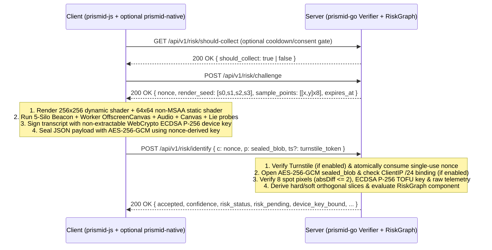

# PrismID Wire & Cryptographic Protocol Specification (`PROTOCOL_SPEC.md`)

This document defines the byte-level cryptographic, mathematical, and JSON schema contracts between `prismid-js` (TypeScript `v1.2.0`), `prismid-native` (Rust `v1.2.0`), and `prismid-go` (Go `v1.2.0`).

---

## 1. Lifecycle Overview (Identify, Rebind/Rotate, Clear-Spoof & Erasure)



---

## 2. Challenge Issuance (`POST /api/v1/risk/challenge`)

### 2.1 Response Schema (`Challenge`)

```json
{
  "nonce": "9f86d081884c7d659a2feaa0c55ad015a3bf4f1b2b0b822cd15d6c15b0f00a08",
  "render_seed": [3.141593, 2.718282, 1.618034, 4.669201],
  "sample_points": [
    [32, 48],
    [96, 64],
    [160, 80],
    [224, 96],
    [48, 144],
    [112, 160],
    [176, 192],
    [208, 224]
  ],
  "issued_at": 1794096000000,
  "expires_at": 1794096060000
}
```

- `nonce`: 32 cryptographically random bytes encoded as 64 lowercase hexadecimal characters. Single-use only (`GETDEL` semantics); default TTL is 60 seconds. In `MemoryChallengeStore` and `RedisStore`, per-IP (`DefaultMaxChallengesPerIP = 64`) and per-`/24`-subnet (`DefaultMaxChallengesPerIPSub = 1024`) quotas prevent floods from evicting unrelated users' pending challenges.
- `render_seed`: Array of 4 floating-point numbers `[s0, s1, s2, s3]` in `[1.25, 6.75]`.
- `sample_points`: Stratified CSPRNG array of 8 coordinate pairs `[x, y]` sampled dynamically per challenge across a `4x2` grid inside `[8, 247]^2` (`Config.StaticSamplePoints` optional for deterministic lab fixtures).
- `issued_at` / `expires_at`: Unix epoch timestamps in milliseconds (or seconds, auto-normalized by `prismid-go`).

---

## 3. Dynamic GLSL Shader & Pixel Verification Math

### 3.1 Canvas & Coordinate System Alignment

- Dynamic challenge canvas dimensions: **`256 x 256`** pixels (`antialias: false`, `preserveDrawingBuffer: true`).
- Static hardware fingerprint canvas dimensions: **`64 x 64`** pixels (`antialias: false`, oversized clip-space triangle `[-1,-1, 3,-1, -1,3]`) in both main thread (`webgl.ts`) and Worker `OffscreenCanvas` (`workerLie.ts`) so cross-thread buffers match bit-for-bit across Chromium, Firefox, and WebKit.
- `gl_FragCoord.xy` evaluates at the half-pixel center `(x + 0.5, y + 0.5)` with `(0, 0)` at the bottom-left corner.

### 3.2 Mathematical Formula (GLSL & Go Reference)

For integer coordinate $(x, y) \in [0, 255]^2$ and seed $[s_0, s_1, s_2, s_3]$:

$$u = \frac{x + 0.5}{256.0}, \quad v = \frac{y + 0.5}{256.0}$$

$$\begin{aligned}
r &= 0.5 + 0.5 \cdot \sin(u \cdot s_0 + v \cdot s_1 + s_2) \\
g &= 0.5 + 0.5 \cdot \cos(u \cdot s_1 - v \cdot s_2 + s_3) \\
b &= 0.5 + 0.5 \cdot \sin((u + v) \cdot s_3 + s_0)
\end{aligned}$$

Each channel $c \in \{r, g, b\}$ is clamped to $[0.0, 1.0]$ and quantized via `round(c * 255.0)`, with alpha $a = 255$. The Go verifier accepts a sample when $|\text{Actual}_c - \text{Expected}_c| \le 2$ and $\text{Actual}_A = 255$.

---

## 4. AEAD (`AES-256-GCM`) Wire Envelope & Non-Extractable `ECDSA P-256` Signatures

### 4.1 Wire Envelope (`IdentifyRequest`)

```json
{
  "c": "9f86d081884c7d659a2feaa0c55ad015a3bf4f1b2b0b822cd15d6c15b0f00a08",
  "p": "<Base64RawURL(IV [12B] || Ciphertext || GCM_Tag [16B])>",
  "ts": "<optional Cloudflare Turnstile / CAPTCHA token>"
}
```

- **Key**: $\text{SHA-256}(\text{UTF8}(\texttt{"prismid-v1-aead:"} \parallel \text{nonce}))$ (32 bytes)
- **IV**: 12 CSPRNG bytes (`crypto.getRandomValues` strictly required; never falls back to `Math.random()`)
- **AAD**: $\text{UTF8}(\text{nonce})$
- **Turnstile (`ts`)**: Validated before decryption when `Config.TurnstileVerifier` / `RequireTurnstile` (`-turnstile-secret`) is configured (`PRISMID_TURNSTILE_VERIFICATION_FAILED` on failure).

### 4.2 WebCrypto `ECDSA P-256` Transcripts (`device_key` & `previous_device_key`)

- **Curve & Encoding**: NIST `P-256` (`secp256r1`) with `SHA-256`.
  - `pub_key`: 65-byte uncompressed SEC1 point (`04 || X[32B] || Y[32B]`), 130 lowercase hex chars.
  - `signature`: 64-byte IEEE P1363 raw `r[32B] || s[32B]` (or ASN.1 DER accepted by Go verifier), 128 lowercase hex chars.
- **Identify Transcript** (`signChallengeWithDeviceKey`):
  ```text
  prismid-v2-sig|<nonce>|<beacon_id_lower>|<static_webgl_fp_hash_lower>|<audio_compressor_hash_lower>
  ```
- **Rebind New-Key Transcript** (`signRebindWithDeviceKey`):
  ```text
  prismid-v2-rebind|<challenge_nonce>|<subject_id>|<beacon_id_lower>
  ```
- **Proactive Rotation Previous-Key Continuity Transcript** (`prepareDeviceKeyRotation` / `rotateDeviceKeyAndSignRebind` / `VerifyECDSAP256PrevKeyRotationProofBound`):
  ```text
  prismid-v2-rebind-prev|<challenge_nonce>|<subject_id>|<beacon_id_lower>|<new_pub_key_lower>
  ```
  > Cryptographically binds `<new_pub_key_lower>` (130-char lowercase uncompressed SEC1 hex) so an attacker intercepting a rotation request cannot substitute their own `device_key`, and requires `prev_pub_key != new_pub_key`. On the client (`prismid-js`), `rebindKey({ rotate: true })` uses two-phase commit (`prepareDeviceKeyRotation`), writing the candidate keypair to `IndexedDB` only after `/api/v1/risk/rebind-key` returns HTTP 200.

---

## 5. Decrypted Payload JSON Schema (`ProbePayload` `v1.1.0`)

```json
{
  "v": 1,
  "nonce": "9f86d081884c7d659a2feaa0c55ad015a3bf4f1b2b0b822cd15d6c15b0f00a08",
  "collected_at": 1794096001120,
  "beacon_id": "a1b2c3d4e5f60718293a4b5c6d7e8f90",
  "device_key": {
    "alg": "ecdsa-p256",
    "pub_key": "04...",
    "signature": "..."
  },
  "webgl": {
    "webgl_available": true,
    "gpu_vendor": "Apple",
    "gpu_renderer": "Apple M1 Pro",
    "webgl_limits_vector": "16384|16384|16384,16384|16384|4096|1024|31|1,1|1,511|16|23,23,23,23",
    "webgl_extensions_hash": "e3b0c44298fc1c14",
    "static_webgl_fp_hash": "7c4a8d09ca3762af61e59520943dc26494f8941b00112233445566778899aabb",
    "spot_pixels": [[182, 114, 209, 255], [241, 63, 198, 255], [129, 25, 118, 255], [34, 88, 41, 255], [212, 190, 239, 255], [251, 142, 165, 255], [97, 44, 62, 255], [19, 102, 85, 255]]
  },
  "audio_compressor_hash": "4a9e8b7c6d5f4e3a2b1c0d9e8f7a6b5c4d3e2f1a0b9c8d7e6f5a4b3c2d1e0f9a",
  "audio_copy_hash": "4a9e8b7c6d5f4e3a2b1c0d9e8f7a6b5c4d3e2f1a0b9c8d7e6f5a4b3c2d1e0f9a",
  "audio_silent_delta": 0,
  "audio_muted": false,
  "system": {
    "user_agent": "Mozilla/5.0 (Macintosh; Intel Mac OS X 10_15_7)...",
    "platform": "MacIntel",
    "cpu_cores": 10,
    "device_memory": 8,
    "timezone": "Asia/Shanghai",
    "languages": ["zh-CN", "en-US"],
    "screen_spec": "1728x1117x30@2",
    "display_gamut_spec": "p3|hdr|fine",
    "intl_hash": "a91f...",
    "voices_hash": "0b2c...",
    "canvas_2d_hash": "8f3d2a1b...",
    "fonts_bitmap_hash": "1c2d3e4f...",
    "canvas_control_rgba": [0, 0, 0, 0, 17, 136, 221, 255],
    "canvas_readback_delta": 0
  },
  "lies": {
    "worker_unavailable": false,
    "worker_webgl_available": true,
    "worker_lie_detected": false,
    "worker_gpu_renderer": "Apple M1 Pro",
    "worker_static_webgl_fp_hash": "7c4a8d09ca3762af61e59520943dc26494f8941b00112233445566778899aabb",
    "worker_cpu_cores": 10,
    "worker_platform": "MacIntel",
    "worker_user_agent": "Mozilla/5.0 (Macintosh; Intel Mac OS X 10_15_7)...",
    "worker_timezone": "Asia/Shanghai",
    "canvas_noise_injected": false,
    "webgl_noise_injected": false,
    "audio_noise_injected": false,
    "storage_healed": false,
    "storage_silos_mask": 31,
    "math_engine_signature": "v8",
    "math_constants_hash": "b9f8e7d6...",
    "prototype_lies": [],
    "automation_flags": []
  },
  "native_anchor": null
}
```

### Field Notes (`v1.1.0`)
- `beacon_id`: Strictly validated as **exact 32-char lowercase hex** (`^[0-9a-f]{32}$`, 128 bits) when non-empty.
- `webgl.webgl_available`: When `false` (hardened Firefox / enterprise policy disabling WebGL), `gpu_vendor = "Unavailable"`, `gpu_renderer = "WebGL Disabled"`. If bound to a verified `d_key_* + d_bcn_*` or `d_nat_*`, server assigns `DisabledWebGLBoundConfidence = 0.75` (`green` + `privacy_signals: ["webgl_disabled_by_client"]`); anonymous stateless requests without WebGL remain `0.30` (`risk_pending: true`).
- `audio_muted`: When `OfflineAudioContext` renders all-zero samples (`0.0`), `audio_muted: true` is sent without triggering `audio_noise_injected`, recorded as `"audio_output_muted"` in `privacy_signals`.
- `system.canvas_control_rgba` & `canvas_readback_delta`: `8`-byte `[blankR, blankG, blankB, blankA, solidR, solidG, solidB, solidA]` control sample (`blank == [0,0,0,0]`, `solid` within `±2` of `[17,136,221,255]` with full spatial uniformity across all 256 patch pixels). Note: Raw telemetry raises the bar against browser extensions and unmodified-SDK hooks, whereas a fully custom client outside the browser can synthesize coherent raw fields.
- `lies.storage_silos_mask`: 5-bit mask (`bit0=localStorage`, `bit1=sessionStorage`, `bit2=cookie`, `bit3=indexedDB`, `bit4=cacheStorage`, `0..31`).
- `lies.math_engine_signature`: `"v8"`, `"jsc"`, `"spidermonkey"`, `"unknown"`, or `"unknown_tampered_math"` (emitted when `Math.*` functions are monkey-patched or violate IEEE-754 determinism).

---

## 6. HTTP Endpoints & Token Formats (`cmd/prismid-server`)

### 6.1 Bearer & Single-Use Step-Up Token Wire Formats

1. **Bearer Subject Token (`SignSubjectBearerToken`)**:
   - Wire string: `<subject_id>.<exp_unix_sec>.<hex(HMAC_SHA256)>`
   - Key derivation: `SHA256("prismid-bearer-auth-v1:" || auth_secret)` (`-auth-secret` / `-auth-secret-prev`)
   - Canonical length-prefixed MAC input:
     `prismid-auth-v2|<len(subject_id)>:<subject_id>|<exp_unix_sec>`
2. **Single-Use Step-Up Token (`SignStepUpToken`)**:
   - Wire string: `stepup_v2.<jti_32hex>.<exp_unix_sec>.<hex(HMAC_SHA256)>`
   - Key derivation: `SHA256("prismid-stepup-auth-v1:" || stepup_secret)` (`-stepup-secret` / `-stepup-secret-prev`)
   - Canonical length-prefixed MAC input (unambiguous even if `subject_id` contains `|` or `.`):
     `prismid-stepup-v2|<len(subject_id)>:<subject_id>|<len(target)>:<target>|<jti_32hex>|<exp_unix_sec>`
   - **Single-use enforcement**: `jti` is atomically consumed on first verification and persisted in `FileStateStore` WAL (`ReplayGuardSnapshot`); replay attempts return `403 Forbidden` even across server restarts.

### 6.2 Lifecycle & Admin HTTP Endpoints

| Method & Path | Auth | Request Body / Params | Behavior |
|---|---|---|---|
| `GET /api/v1/risk/should-collect` | Bearer (optional) | — | Returns `{ "should_collect": bool }`. When `false`, `prismid-js` returns `{ accepted: false, skipped: true, code: "COLLECTION_SKIPPED" }`. |
| `POST /api/v1/risk/challenge` | Bearer | `{}` | Issues 60s single-use `Challenge`; returns `429 Too Many Requests` (`CHALLENGE_RATE_LIMITED`) when per-IP (`64`) or per-`/24` (`1024`) active challenge quota is saturated. |
| `POST /api/v1/risk/identify` | Bearer | `{ c, p, ts? }` | Decrypts & verifies payload, records beacon ownership + graph observation, returns `VerifyResult` + `ComponentSnapshot`. |
| `POST /api/v1/risk/rebind-key` | Bearer + (`step_up_token` **or** `previous_device_key`) | `{ challenge_nonce, beacon_id, device_key, previous_device_key?, step_up_token? }` | Verifies beacon ownership (co-owners on shared devices supported + persistent store fallback), authorizes via either previous-key ECDSA continuity signature or single-use `step_up_token` (`target = d_bcn_*`), retires old `d_key_*` graph edge, updates TOFU binding, and appends audit record. |
| `POST /api/v1/risk/clear-spoof` | Bearer + `step_up_token` | `{ step_up_token }` (`target = "clear_spoof"`) | Consumes single-use step-up token, clears active spoof cooldown (`HistoricalSpoof` `+1.5` log-odds retained), and records structured `clear_spoof` audit event. |
| `GET /api/v1/risk/explain` | Bearer | — | Returns `ComponentSnapshot` (`risk_status`, `log_odds_score`, `evidence_chain`, `slice_ids`). |
| `DELETE /api/v1/risk/subject` | Bearer | — | Complete GDPR/CCPA erasure: removes subject edges, persistent beacon ownership, AND `beaconToKey` TOFU bindings (including shared beacons), and records `erase_subject` audit event. |
| `POST /api/v1/risk/admin/mint-bearer` | `X-PrismID-Admin-Secret` | `{ subject_id, ttl_seconds? }` | Mints signed bearer token for standalone deployments. |
| `POST /api/v1/risk/admin/mint-step-up` | `X-PrismID-Admin-Secret` | `{ subject_id, target \| beacon_id, ttl_seconds? }` | Mints single-use `stepup_v2` token for `rebind-key` or `clear-spoof`. |
| `POST /api/v1/risk/admin/revoke-token` | `X-PrismID-Admin-Secret` | `{ token?, subject_id?, ttl_seconds? }` | Immediately revokes a bearer token or subject session window (persisted across restarts via `-state-file` WAL). |
| `POST /api/v1/risk/admin/prune-graph` | `X-PrismID-Admin-Secret` | `{}` | Prunes expired graph edges, compacts `-state-file`, and returns live `GraphStats`. |
| `POST /api/v1/risk/admin/flush-state` | `X-PrismID-Admin-Secret` | `{}` | Compacts `<state-file>.wal` into `<state-file>` atomically on demand and returns `persist_errors`. |
| `GET /metrics` | `X-PrismID-Admin-Secret` (unless `-metrics-public`) | — | Exposes Prometheus `0.0.4` counters, latency histograms, and live `RiskGraph` gauges. |

### 6.3 Trusted Ingress Headers, Shadow Mode & Multi-Tenancy

- **Trusted Proxy CIDRs (`-trusted-proxy-cidrs` / `PRISMID_TRUSTED_PROXY_CIDRS`)**: Strips `X-Forwarded-For` hops right-to-left until the first untrusted IP and extracts optional network-layer fingerprint headers (`X-PrismID-JA4` / `X-TLS-JA4` / `CF-JA4`, `X-PrismID-JA3` / `X-TLS-JA3`, `X-PrismID-H2-Fingerprint` / `X-HTTP2-Fingerprint`) **only** when `RemoteAddr` belongs to a configured CIDR.
- **Shadow Mode (`-shadow-mode` / `PRISMID_SHADOW_MODE=true`)**: Executes full `VerifyAndDeriveWithTransport` + `RiskGraph` scoring and records Prometheus verdicts (`shadow="true"`), returning `"shadow_mode": true`, `"shadow_risk_status"`, and `"shadow_risk_pending"` while overriding `"risk_status": "green"` and `"risk_pending": false`.
- **Multi-Tenant Isolation (`-enable-multi-tenant` / `X-PrismID-Tenant-ID`)**: Scopes HMAC slice derivation (`tenant:<len>:<id>|...`) and `RiskGraph` subject namespaces (`t:<id>:<subject>`) per tenant (`^[a-zA-Z0-9_-]{1,64}$`).
