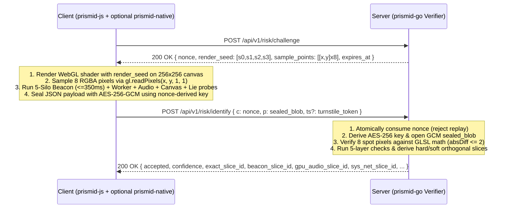

# PrismID Wire & Cryptographic Protocol Specification (`PROTOCOL_SPEC.md`)

This document defines the byte-level cryptographic, mathematical, and JSON schema contracts between `prismid-js` (TypeScript `v1.0.0`), `prismid-native` (Rust `v1.0.0`), and `prismid-go` (Go `v1.0.0`).

---

## 1. Challenge-Identify Lifecycle Overview



---

## 2. Step 1: Challenge Issuance (`IssueChallenge`)

### 2.1 Response Schema (`Challenge`)

```json
{
  "nonce": "9f86d081884c7d659a2feaa0c55ad015a3bf4f1b2b0b822cd15d6c15b0f00a08",
  "render_seed": [3.141593, 2.718282, 1.618034, 4.669201],
  "sample_points": [
    [32, 48],
    [96, 64],
    [160, 80],
    [224, 96],
    [48, 144],
    [112, 160],
    [176, 192],
    [208, 224]
  ],
  "issued_at": 1794096000000,
  "expires_at": 1794096060000
}
```

- `nonce`: 32 cryptographically random bytes encoded as 64 lowercase hexadecimal characters. Single-use only (`GETDEL` semantics); default TTL is 60 seconds.
- `render_seed`: Array of 4 floating-point numbers `[s0, s1, s2, s3]` in the inclusive range `[1.25, 6.75]` (`1.25 + float64(n)/10000.0 * 5.5` where $n \in [0, 9999]$).
- `sample_points`: Array of 8 coordinate pairs `[x, y]` where $0 \le x < 256$ and $0 \le y < 256$.
- `issued_at` / `expires_at`: Unix epoch timestamps in milliseconds (or seconds, auto-normalized by `prismid-go`).

---

## 3. Step 2: Dynamic GLSL Shader & Pixel Verification Math

### 3.1 Canvas & Coordinate System Alignment

- Canvas dimensions MUST be fixed at **`256 x 256`** pixels (`width = 256`, `height = 256`).
- In OpenGL ES / WebGL fragment shaders, `gl_FragCoord.xy` evaluates at the **half-pixel center** `(x + 0.5, y + 0.5)` for integer pixel `(x, y)`, with `(0, 0)` at the bottom-left corner.
- `gl.readPixels(x, y, 1, 1, gl.RGBA, gl.UNSIGNED_BYTE, buf)` also uses `(0, 0)` at the bottom-left corner.

### 3.2 Mathematical Formula (GLSL & Go Reference)

For any integer pixel coordinate $(x, y) \in [0, 255]^2$ and seed $[s_0, s_1, s_2, s_3]$:

$$u = \frac{x + 0.5}{256.0}, \quad v = \frac{y + 0.5}{256.0}$$

$$\begin{aligned}
r &= 0.5 + 0.5 \cdot \sin(u \cdot s_0 + v \cdot s_1 + s_2) \\
g &= 0.5 + 0.5 \cdot \cos(u \cdot s_1 - v \cdot s_2 + s_3) \\
b &= 0.5 + 0.5 \cdot \sin((u + v) \cdot s_3 + s_0)
\end{aligned}$$

Each channel $c \in \{r, g, b\}$ is clamped to $[0.0, 1.0]$ and quantized to an 8-bit unsigned integer $[0, 255]$ via `round(c * 255.0)`, with alpha $a = 255$.

### 3.3 Quantization Tolerance & Trust Boundary (`shader_math.go`)

- The Go verifier computes the expected $[R, G, B, 255]$ for each of the 8 `sample_points` and accepts a sample if and only if for every channel:
  $$|\text{Actual}_c - \text{Expected}_c| \le 2, \quad \text{and} \quad \text{Actual}_A == 255$$
- When a WebGL context exists (`gl != null`), `webgl.ts` strictly reads pixels from the GPU framebuffer without falling back to CPU math; if the WebGL shader fails to compile or link, `spot_pixels` are filled with `[0, 0, 0, 0]` so the server rejects the broken/stubbed WebGL context.
- **Security Note**: Because the formula above is deterministic and public, an external script outside the browser can compute expected pixels on a CPU. The spot-pixel check guarantees freshness and blocks random/replay payloads, while in-browser hooks are caught by Layers 2–4.

---

## 4. Step 3: AEAD (AES-256-GCM) Cryptographic Envelope

1. **Key Derivation**:
   $$\text{Key} = \text{SHA-256}\big(\text{UTF8}(\texttt{"prismid-v1-aead:"} \parallel \text{challenge.nonce})\big)$$
2. **Initialization Vector (IV)**:
   - 12 cryptographically random bytes generated per encryption call (`crypto.getRandomValues(new Uint8Array(12))`).
3. **Additional Authenticated Data (AAD)**:
   $$\text{AAD} = \text{UTF8}(\text{challenge.nonce})$$
4. **Ciphertext Wire Format**:
   $$\text{RawEnvelope} = \text{IV}_{[0..12)} \parallel \text{Ciphertext}_{[12..N-16)} \parallel \text{GCM\_Tag}_{[N-16..N)}$$
   $$\text{SealedBlob} = \text{Base64RawURL}(\text{RawEnvelope})$$

> [!NOTE]
> Because `challenge.nonce` is transmitted in the challenge response, the AEAD envelope serves as **transport payload obfuscation and nonce-binding** (preventing trivial F12 plaintext editing and binding ciphertext to the single-use `nonce`), not as client-identity authentication. Always run `/api/v1/risk/*` over HTTPS/TLS in production.

---

## 5. Decrypted Payload JSON Schema (`ProbePayload`)

```json
{
  "v": 1,
  "nonce": "9f86d081884c7d659a2feaa0c55ad015a3bf4f1b2b0b822cd15d6c15b0f00a08",
  "collected_at": 1794096001120,
  "beacon_id": "a1b2c3d4e5f60718293a4b5c6d7e8f90",
  "webgl": {
    "webgl_available": true,
    "gpu_vendor": "Apple",
    "gpu_renderer": "Apple M1 Pro",
    "webgl_limits_vector": "16384|16384|16384,16384|16384|4096|1024|31|1,1|1,511|16|23,23,23,23",
    "webgl_extensions_hash": "e3b0c442",
    "static_webgl_fp_hash": "7c4a8d09ca3762af61e59520943dc26494f8941b00112233445566778899aabb",
    "spot_pixels": [
      [182, 114, 209, 255],
      [241, 63, 198, 255],
      [129, 25, 118, 255],
      [34, 88, 41, 255],
      [212, 190, 239, 255],
      [251, 142, 165, 255],
      [97, 44, 62, 255],
      [19, 102, 85, 255]
    ]
  },
  "audio_compressor_hash": "4a9e8b7c6d5f4e3a2b1c0d9e8f7a6b5c4d3e2f1a0b9c8d7e6f5a4b3c2d1e0f9a",
  "system": {
    "user_agent": "Mozilla/5.0 (Macintosh; Intel Mac OS X 10_15_7)...",
    "platform": "MacIntel",
    "cpu_cores": 10,
    "device_memory": 8,
    "timezone": "Asia/Shanghai",
    "languages": ["zh-CN", "en-US"],
    "screen_spec": "1728x1117x30@2",
    "canvas_2d_hash": "8f3d2a1b...",
    "fonts_bitmap_hash": "1c2d3e4f..."
  },
  "lies": {
    "worker_unavailable": false,
    "worker_lie_detected": false,
    "worker_gpu_renderer": "Apple M1 Pro",
    "worker_static_webgl_fp_hash": "7c4a8d09ca3762af61e59520943dc26494f8941b00112233445566778899aabb",
    "worker_cpu_cores": 10,
    "worker_platform": "MacIntel",
    "worker_user_agent": "Mozilla/5.0 (Macintosh; Intel Mac OS X 10_15_7)...",
    "worker_timezone": "Asia/Shanghai",
    "canvas_noise_injected": false,
    "audio_noise_injected": false,
    "storage_healed": false,
    "math_engine_signature": "v8",
    "math_constants_hash": "b9f8e7d6...",
    "prototype_lies": [],
    "automation_flags": []
  },
  "native_anchor": {
    "platform": "macos",
    "hw_uuid": "FD7FC36D-XXXX-XXXX-XXXX-XXXXXXXXXXXX",
    "serial_number": "T41KH4C9TF",
    "keychain_anchor": "a1b2c3d4...",
    "cpu_brand": "Apple M1 Pro",
    "cpu_cores": 10,
    "memory_bytes": 17179869184,
    "is_vm": false,
    "vm_vendor": ""
  }
}
```
*(Note: `native_anchor` is omitted or `null` when running in a standard browser tab.)*
